<h1 align="center">Zapive</h1>

<p align="center"><strong>A native WhatsApp desktop client written in Rust.</strong><br>
One executable, no browser engine, private by default.</p>

<p align="center">
  <a href="https://github.com/wilssola/zapive/actions/workflows/build.yml"></a>
  <a href="https://github.com/wilssola/zapive/releases/latest"></a>
  <a href="LICENSE"></a>
  
  
</p>

<p align="center">
  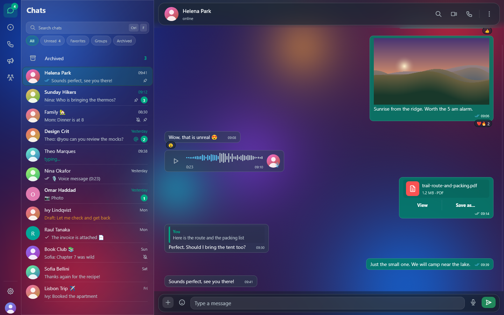
</p>

Zapive links to your phone as a WhatsApp companion device, the same way
WhatsApp Web does, and runs as a single native process built with
[whatsapp-rust](https://github.com/jlucaso1/whatsapp-rust) and
[Slint](https://slint.dev). Everything happens on your computer: voice and
video calls, media decoding, full-text search, and even message
translation.

> [!IMPORTANT]
> Zapive is an independent project. It is not affiliated with or endorsed
> by WhatsApp or Meta. Unofficial clients may break WhatsApp's terms of
> service; if account safety matters to you, use a secondary number.

## Highlights

- **Offline translation on your machine.** Messages are translated by
  [CTranslate2](https://github.com/OpenNMT/CTranslate2) running inside the
  app with Argos OPUS-MT models. Once a model is installed, no text leaves
  the computer.
- **Voice and video calls.** One-to-one calls with mute, camera on/off and
  your choice of microphone, speaker and camera.
- **Everything on disk is encrypted.** Chats, message history, media and
  avatars are sealed with AES-256-GCM. The data key is wrapped by the OS key
  store (DPAPI, macOS Keychain or Secret Service) and, if you choose, by a
  PIN.
- **Search without plaintext.** Full-text search on SQLite FTS5 over keyed,
  prefix-preserving word hashes, with encrypted snippets.
- **Privacy by default.** Read receipts stay off, and a message the sender
  deletes stays visible here unless you change either setting. You can also
  blur names, photos, message text and media.
- **Built-in viewers.** PDF preview, a status/stories viewer, a streaming
  video player, and voice notes at up to 3x speed with the pitch preserved.
- **Updates itself.** Checks GitHub Releases, verifies the SHA-256 checksum,
  swaps the binary and shows what's new.
- **Optional AI integration.** A local MCP server (off by default, behind a
  token) lets AI assistants such as Claude or Cursor work with your chats.
- **Light on resources.** About 140–180 MB of RAM with roughly 900 chats
  loaded (see [Performance](#performance)).

## Screenshots

All screenshots come from [demo mode](docs/demo-mode.md) and show invented
data only.

| Dark · Liquid Glass | Light · Liquid Glass |
| --- | --- |
|  | 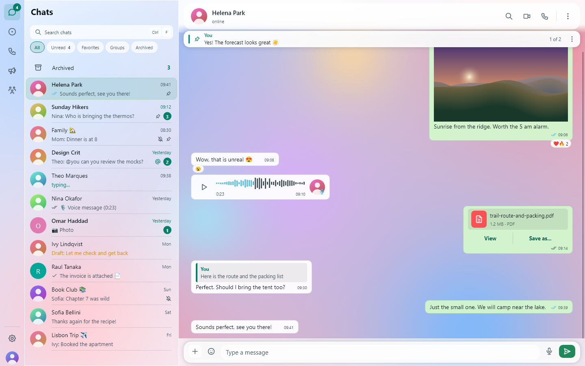 |
| **Dark · Opaque** | **Light · Opaque** |
| 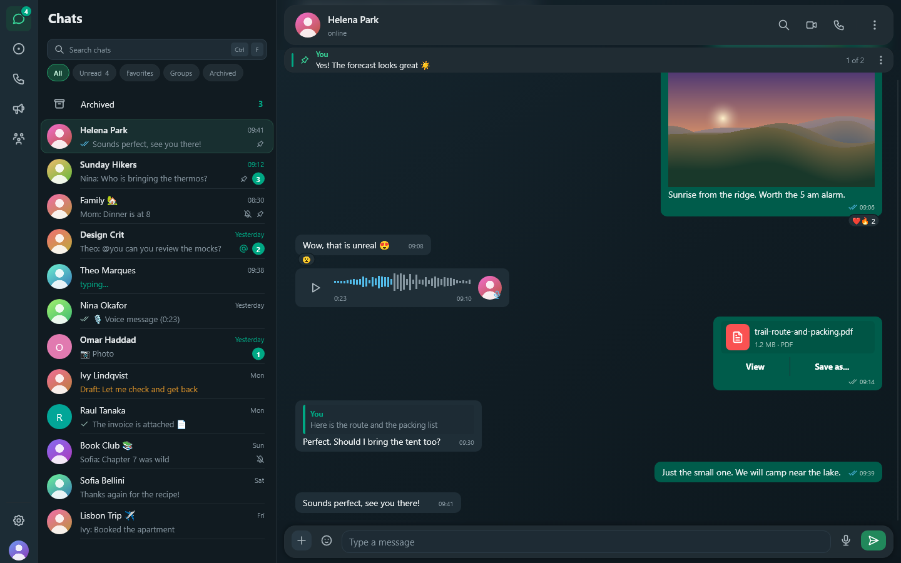 | 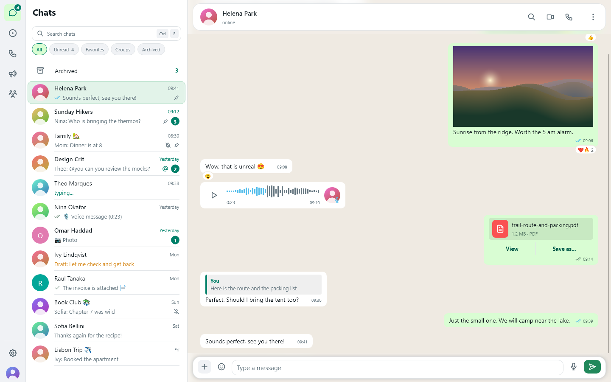 |
| **Settings** | **Contact / group info** |
| 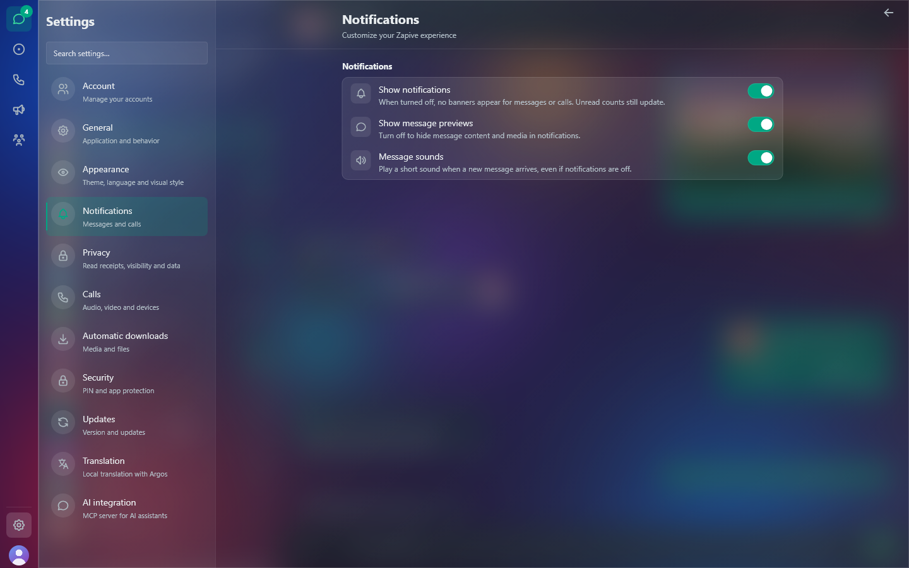 | 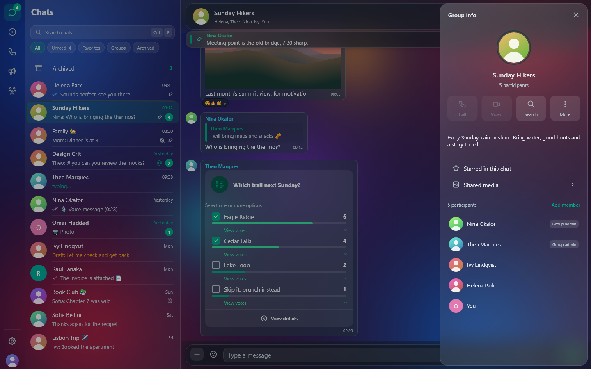 |
| **Polls** | **Creating a poll** |
| 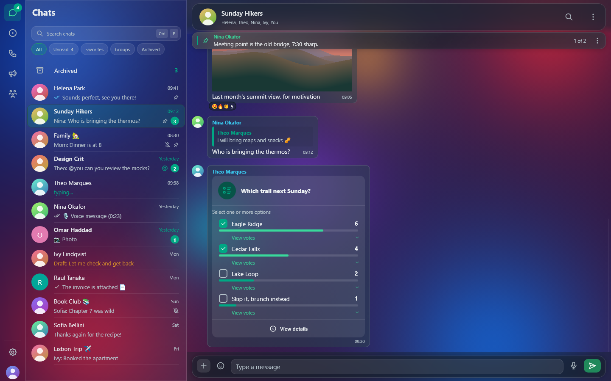 | 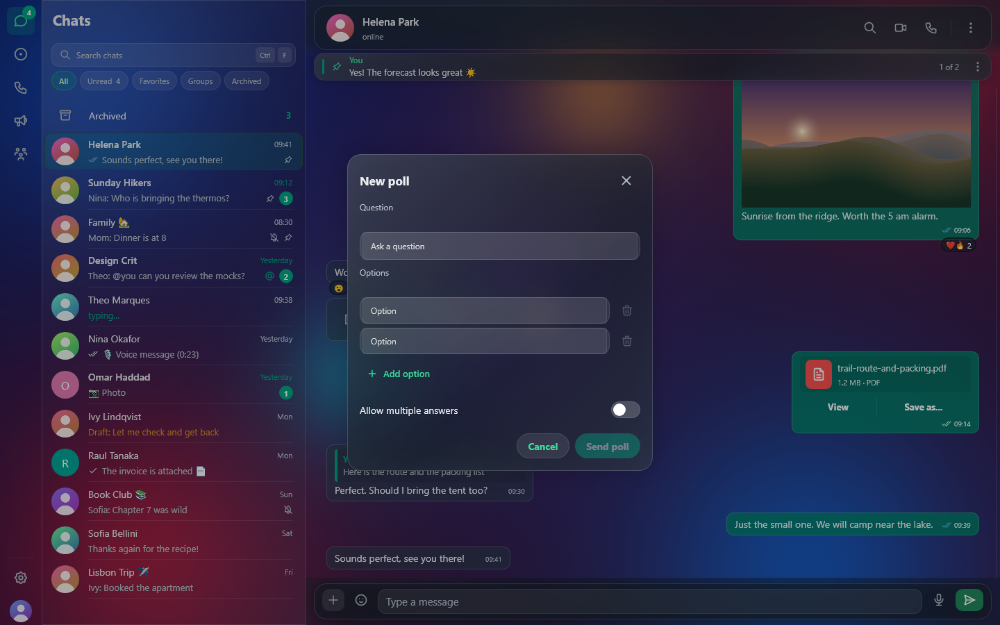 |
| **Starred messages** | **Reaction details** |
| 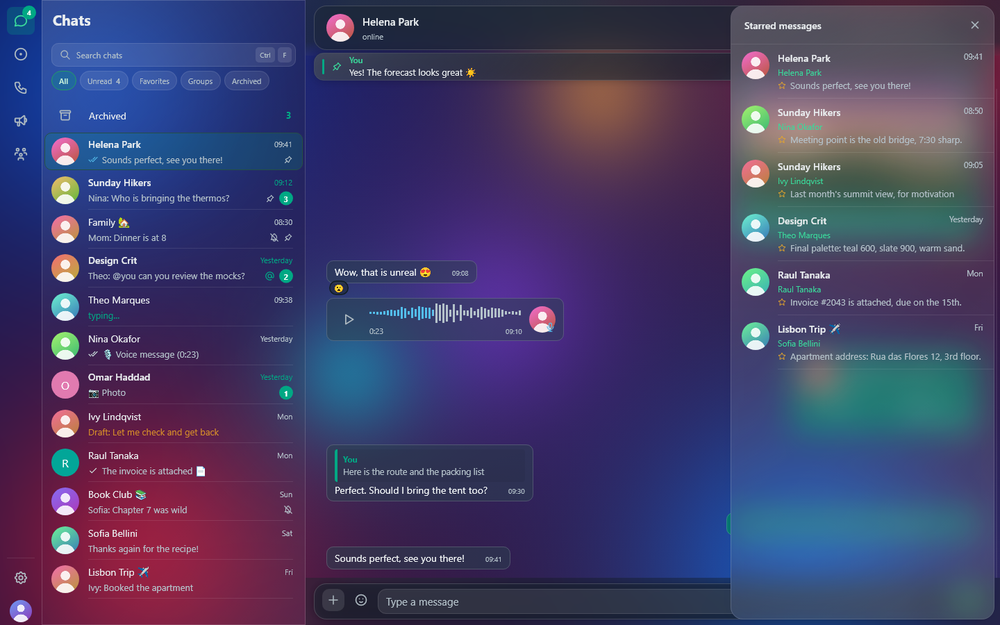 | 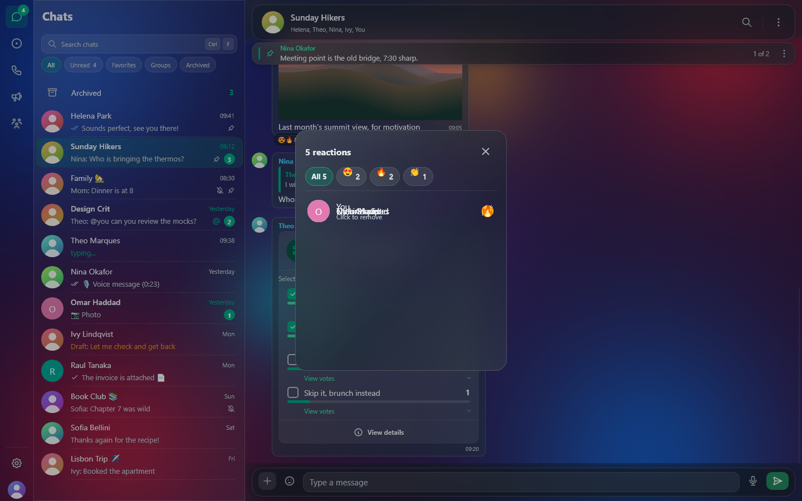 |
| **Drag and drop** | **Keyboard shortcuts** |
| 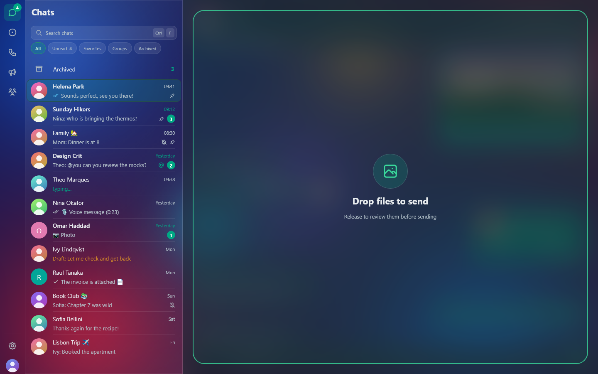 | 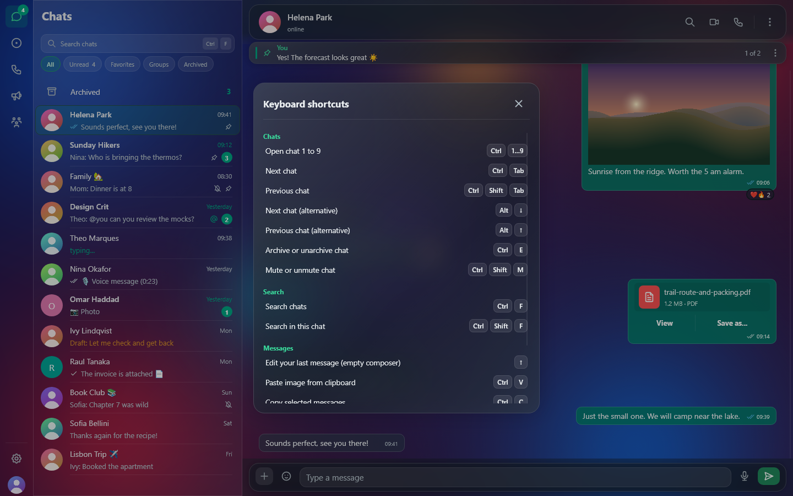 |
| **Linking a phone** | **Loading** |
| 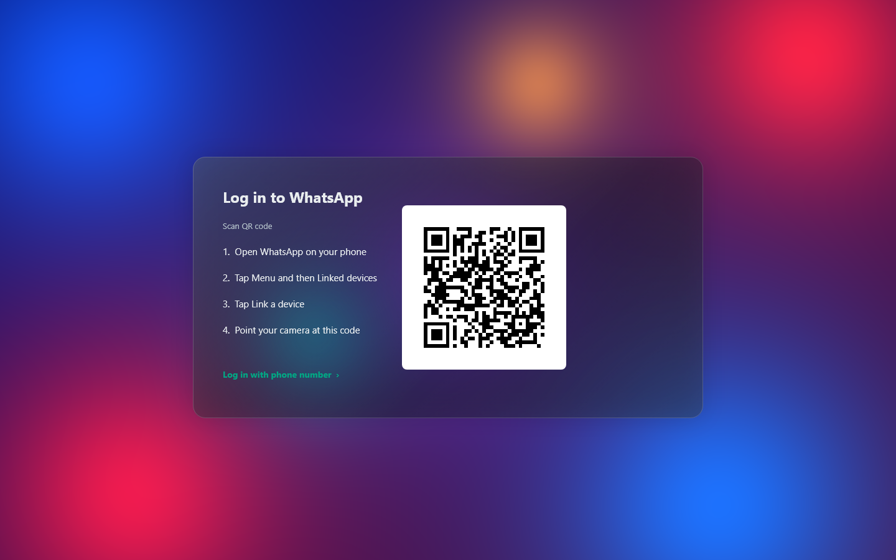 | 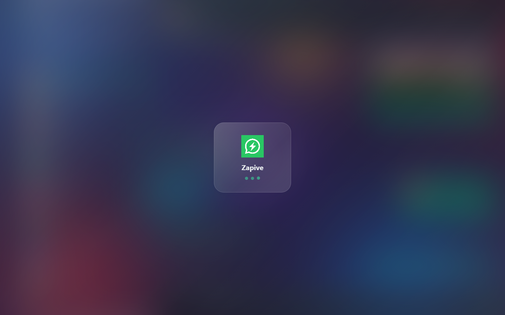 |

## Download and install

Releases are published at
[github.com/wilssola/zapive/releases](https://github.com/wilssola/zapive/releases).

| Platform | File | Notes |
| --- | --- | --- |
| Windows 10/11 (x64) | `Zapive-Setup-<version>.exe` | Inno Setup installer. The binary is self-signed, so SmartScreen may warn on first run. |
| Linux (x86_64) | `Zapive-<version>-x86_64.AppImage` | `chmod +x` it and run. Install `secret-tool` (libsecret) so the vault key goes into your keyring. |
| macOS 11+ (Apple silicon) | `Zapive-<version>.dmg` | Self-signed: the first time, right-click the app and choose **Open**. |

A Flatpak manifest exists but is not published yet. See
[docs/getting-started.md](docs/getting-started.md) for step-by-step
instructions.

## Quick start

1. Start Zapive. The login screen shows a QR code.
2. On your phone, open WhatsApp → **Settings → Linked devices → Link a
   device**.
3. Scan the QR code, **or** choose to link with a phone number and type the
   8-character code Zapive shows.
4. Your chat list appears as soon as the first sync arrives. History keeps
   arriving in the background.

## Features

Full details are in [docs/features.md](docs/features.md).

**Messaging**
- Chat list with pinned, archived and muted chats, unread and mention
  badges, filters (All, Unread, Favorites, Groups, Archived), custom lists,
  channels and communities.
- WhatsApp formatting (`*bold*`, `_italic_`, `~strike~`, ```` ```mono``` ````),
  replies with a quote, reactions, forwarding, editing, starring, pinning
  and deleting (for me or for everyone).
- **Polls:** create them (up to 12 options, single or multiple answers),
  vote, and see live results with who voted for what.
- **Starred messages** panel (all chats or the current one), a **pinned
  messages banner** under the chat header, and **reaction details**
  grouped by emoji.
- Group read receipts turn blue only when **every** member has read the
  message.
- `@` mentions with a member picker, per-chat drafts, link previews, and a
  multi-message selection mode with copy, forward, delete and export.
- Disappearing messages (off, 24 h, 7 days, 90 days), group member
  management for admins, and chat export to `.txt`.
- Messages queue in an outbox while you are offline and are sent when the
  connection comes back.

**Media**
- Photos, videos, GIFs, stickers, documents and voice notes, sent and
  received. You can crop a photo before sending, paste an image from the
  clipboard, and send a photo as view-once.
- **Drag and drop** up to 10 files onto the window and review each one
  before it is sent.
- Voice notes at 1x, 1.5x, 2x, 2.5x and 3x with the pitch preserved (WSOLA)
  and real waveforms. Recording encodes straight to Ogg/Opus.
- Streaming video player with seek, volume and keyboard controls, an image
  lightbox, a media gallery in the info panel, and an in-app PDF viewer.
- GIF search through Openverse, and automatic downloads you can turn off
  per media type.

**Calls**
- One-to-one voice and video calls with mute, camera toggle and device
  selection, plus a call log. Group calls are not supported yet.

**Privacy and security**
- Encrypted vault, an encrypted search index, an optional PIN on launch,
  read receipts off by default, deletions by the sender kept, and blurring
  of names, photos, text and media. Read the
  [privacy model](#privacy-model).

**Translation**
- Translate any message, or translate a language automatically every time,
  between English, Portuguese, Spanish, French, German, Chinese, Japanese,
  Russian, Italian and Arabic. The source language can be detected
  automatically. See [docs/translation.md](docs/translation.md).

**AI / MCP**
- Opt-in MCP server on `127.0.0.1` with seven tools: list, read and search
  chats, get chat info, send a message, mark as read and react. See
  [docs/mcp.md](docs/mcp.md) before you enable it.

**Appearance and desktop**
- Liquid Glass (translucent) or Opaque style; dark, light or system theme;
  English or Portuguese UI.
- **Chat wallpaper** with custom background and doodle colours (presets
  or any hex value) and doodle intensity.
- **Keyboard shortcuts** for switching, archiving and muting chats,
  searching and editing, with a `Ctrl+/` help screen.
- Native notifications where a click opens the chat, inline reply and a
  play button for voice notes on Windows (open and play on Linux), and a
  message chime you can switch off. See [docs/notifications.md](docs/notifications.md).
- System tray on Windows, start at login, single instance, and up to five
  WhatsApp accounts.

## Privacy model

- **Encrypted at rest:** message history, chat data, media and avatar cache,
  the MCP token, translation settings and the search snippets. A random
  256-bit data key encrypts them with AES-256-GCM. The key is wrapped by
  the OS key store and, with a PIN, also by a key derived from the PIN with
  scrypt.
- **Not encrypted:** whatsapp-rust's protocol store (`wa.db`, protected by
  file permissions), basic app preferences (theme, language, toggles, the
  account list), the log file, and decrypted temporary copies of files you
  open in another app, which are deleted at the next launch.
- **Nothing leaves your computer** except WhatsApp traffic itself, link
  previews, GIF searches, update checks, and the one-time downloads of
  translation models and the PDF engine.

The details, including the MCP risks, are in
[docs/privacy-and-security.md](docs/privacy-and-security.md).

## Performance

| Metric | Value (Windows, measured by the maintainers) |
| --- | --- |
| Executable | about 37 MB (Windows also ships the CTranslate2 DLLs) |
| RAM at start | about 140 MB |
| RAM connected, ~900 chats | about 180 MB |

Chats load lazily. Opening a chat, or resting the pointer on one for
120 ms, loads its latest messages from the vault, and at most 8 chats stay
"warm" in memory.

## Architecture

| Layer | Crates |
| --- | --- |
| WhatsApp protocol and calls | `whatsapp-rust` (Signal sessions, WebSocket, media, VoIP with the pure-Rust MLOW codec) |
| UI | `slint` (winit backend, Skia software renderer, AccessKit accessibility) |
| Storage | `rusqlite` (SQLite + FTS5), `aes-gcm`, `scrypt`, `hmac`/`sha2` |
| Audio | `opus-pure`, `ogg`, `symphonia`, `cpal` |
| Video and camera | `mp4`, `openh264`, `nokhwa`, `image`, `webp` |
| Translation | `ct2rs` (CTranslate2), `sentencepiece`, `lingua` |
| PDF | `pdfium-render` (pdfium downloaded on first use) |
| MCP | `rust-mcp-sdk`, `axum` |
| Runtime | `tokio` next to the Slint event loop, connected by command channels |

Module map: [docs/architecture.md](docs/architecture.md).

## Build from source

```sh
# Windows (PowerShell): fetch the official CTranslate2 DLL once
./scripts/fetch-ctranslate2.ps1

cargo build --release --locked
```

| Platform | Extra requirements |
| --- | --- |
| Windows | MSVC Build Tools; `scripts/fetch-ctranslate2.ps1` |
| Linux | `libasound2-dev libgtk-3-dev libxdo-dev cmake build-essential` |
| macOS | `cmake` (CTranslate2 is built from source) |

See [docs/building.md](docs/building.md) for checks, self-tests and
packaging.

## Demo mode

Demo mode runs the real UI on invented data in a throwaway directory. It
never connects to WhatsApp and never touches your real data. It is only
compiled with the `demo` feature:

```sh
cargo run --features demo -- --demo                       # explore
cargo run --features demo -- --demo-shots-all docs/screenshots   # regenerate screenshots
```

See [docs/demo-mode.md](docs/demo-mode.md).

## Not yet supported

- Group calls, call links and screen sharing; posting statuses.
- Blocking contacts, creating groups, invite links and `wa.me` deep links.
- Locked chats, auto-lock after inactivity, proxy settings, and
  typing/last-seen privacy settings.
- Sticker packs (import or create), interactive/business messages, sending
  locations, broadcast lists, albums.
- Full screen-reader coverage; more UI languages.
- macOS notifications have no actions, and clicking one does not open the
  chat yet. Linux and macOS builds are tested less than Windows.

## Contributing

Read [CONTRIBUTING.md](CONTRIBUTING.md) (build, checks, i18n and commit
rules) and [SECURITY.md](SECURITY.md) for reporting vulnerabilities
privately. Release notes are generated from Conventional Commits; see
[docs/releases.md](docs/releases.md).

## Documentation

[docs/index.md](docs/index.md): getting started, features, privacy and
security, translation, MCP, notifications, appearance, architecture,
building, demo mode, releases, troubleshooting and FAQ.

## License

Zapive is open source under the [MIT License](LICENSE). Third-party components keep their own licenses, including
[Tabler Icons](https://github.com/tabler/tabler-icons) (MIT), Noto Color
Emoji (OFL) and the Unicode emoji data.

## Credits

[whatsapp-rust](https://github.com/jlucaso1/whatsapp-rust) ·
[Slint](https://slint.dev) ·
[CTranslate2](https://github.com/OpenNMT/CTranslate2) and
[Argos Translate](https://github.com/argosopentech/argos-translate) ·
[opus-pure](https://docs.rs/opus-pure) ·
[openh264](https://github.com/ralfbiedert/openh264-rs) ·
[pdfium-binaries](https://github.com/bblanchon/pdfium-binaries) ·
[Tabler Icons](https://github.com/tabler/tabler-icons)
