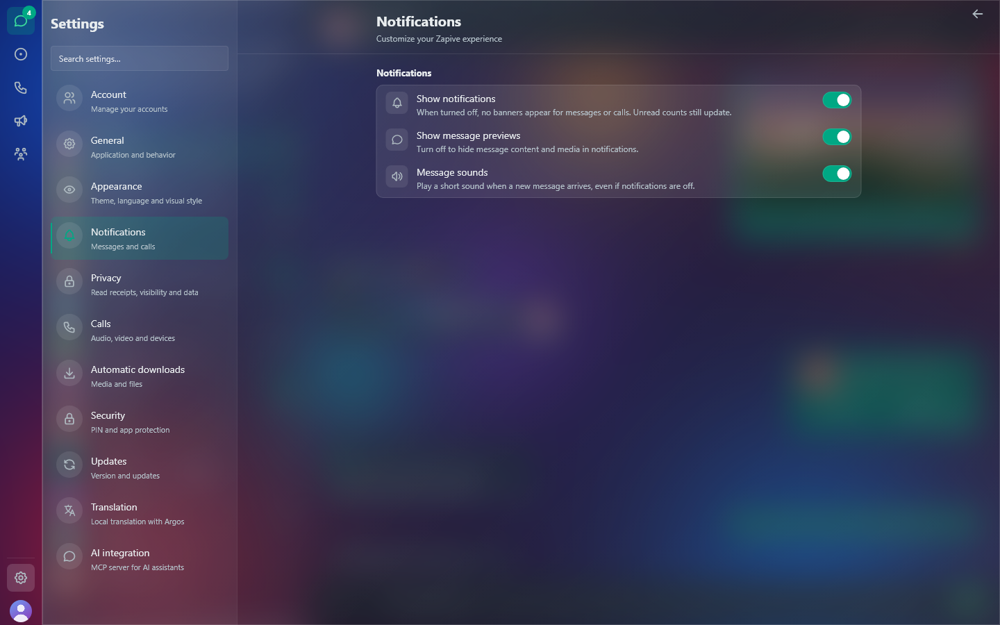
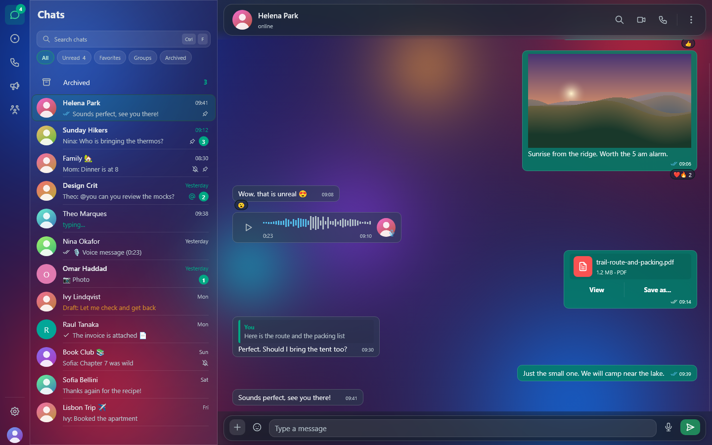
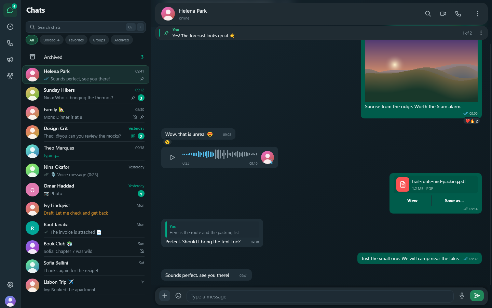
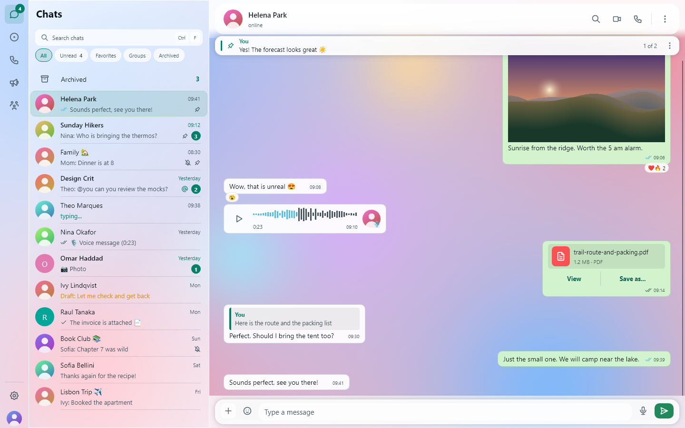
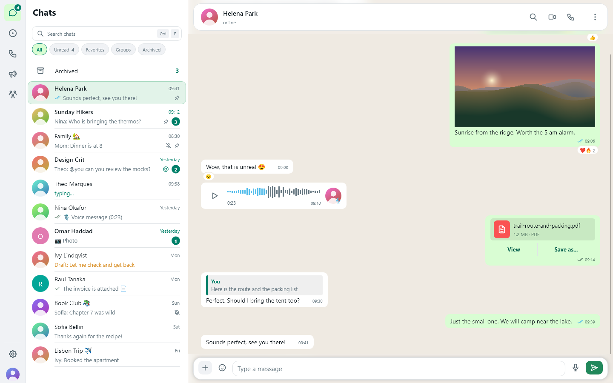

# Appearance

Settings are in **Settings → Appearance** and **Settings → General**.



## Style: Liquid Glass or Opaque

| Liquid Glass (default) | Opaque |
| --- | --- |
|  |  |
|  |  |

**Liquid Glass** makes the window translucent: the desktop shows through
a native OS backdrop. Panels get a translucent fill, a bright 1 px rim
and a soft sheen. Floating surfaces such as menus, popovers and dialogs
also blur what is drawn behind them.

**Opaque** draws the same layout with solid, flat surfaces. It is easier
on slower machines and remote desktops, and some people simply prefer
it.

Liquid Glass needs a native backdrop. When one isn't available, Zapive
automatically uses the opaque look even if Liquid Glass is selected:

| Platform | Backdrop |
| --- | --- |
| Windows 11 22H2 (build 22621) or newer | System backdrop (acrylic "transient window"), with the title bar matched to the theme |
| Windows 10 / older Windows 11 | Not available, opaque look |
| macOS | Window blur |
| Linux, KDE Plasma on Wayland | Compositor blur |
| Other Linux desktops / X11 | Not available, opaque look |

The glass look is also dropped **while the window is not focused**, because
an unfocused OS backdrop turns flat grey. It comes back when the window
regains focus.

The choice is stored as `theme_style` (`glass` or `opaque`).

## Theme: dark, light or system

- **Dark** (default) or **Light**.
- **System** follows the OS setting and is checked again every 15 seconds:
  - Windows: the apps light/dark setting;
  - macOS: the system appearance;
  - Linux: GNOME's `color-scheme` (`gsettings`).
- On Windows, the title bar colour follows the theme.

Stored as `theme` (`dark`, `light` or `system`).

## Chat wallpaper

**Settings → Appearance → Chat wallpaper** customises the doodle pattern
behind conversations:

- **Background colour** and **Doodle colour**: pick one of the presets
  (light and dark tones) or type any `#rrggbb` value. Invalid values are
  ignored.
- **Intensity**: a slider for how strongly the doodles show.
- A live preview with an incoming and an outgoing bubble shows the result.
- **Reset to default** returns to the theme's own wallpaper, which follows
  dark or light.

Stored as `chat_wallpaper_bg` and `chat_wallpaper_fg` (hex; empty means the
default).

## Language

**Settings → General → Language:** System, English or Portuguese. **System**
uses the OS locale and falls back to English. Restart Zapive to apply the
change.

Every UI text goes through the gettext catalogs in
`i18n/en_US/LC_MESSAGES/zapive.po` and `i18n/pt/LC_MESSAGES/zapive.po`, with
semantic ids. To add a language, see [CONTRIBUTING.md](../CONTRIBUTING.md).

## Emoji and fonts

Colour emoji come from the bundled **Noto Color Emoji** font (OFL), so
they render the same on every OS.

## Privacy blur

**Settings → Privacy** can blur contact names, profile photos, message
text and media previews. Hover over an item or give it keyboard focus to
reveal just that item. This is useful in public places or while sharing
your screen.

## Regenerating screenshots

The images on this page come from demo mode:

```sh
cargo run --features demo -- --demo-shots-all docs/screenshots
```

See [demo-mode.md](demo-mode.md).
