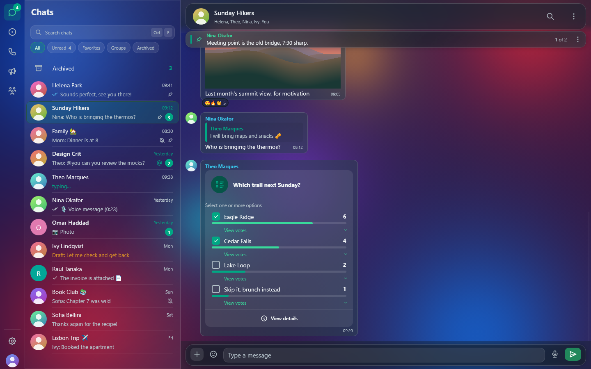
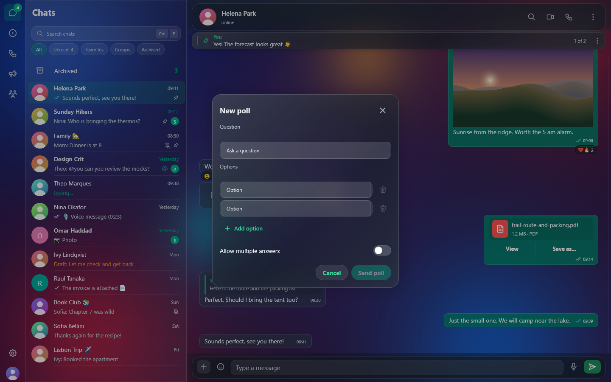
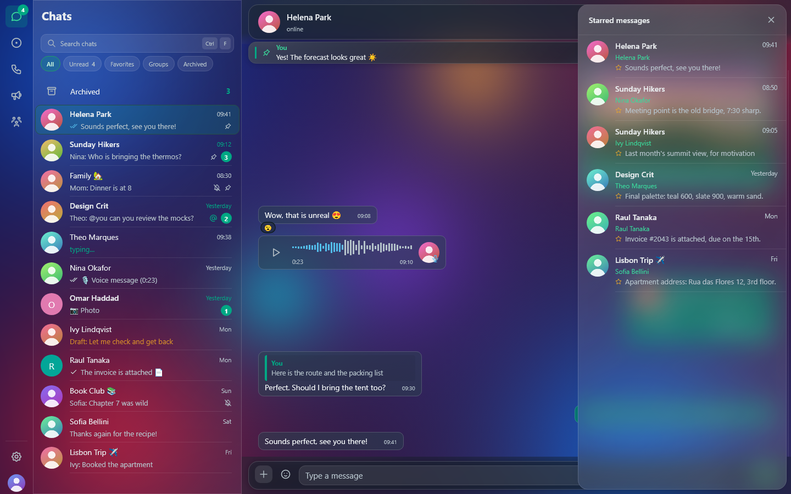
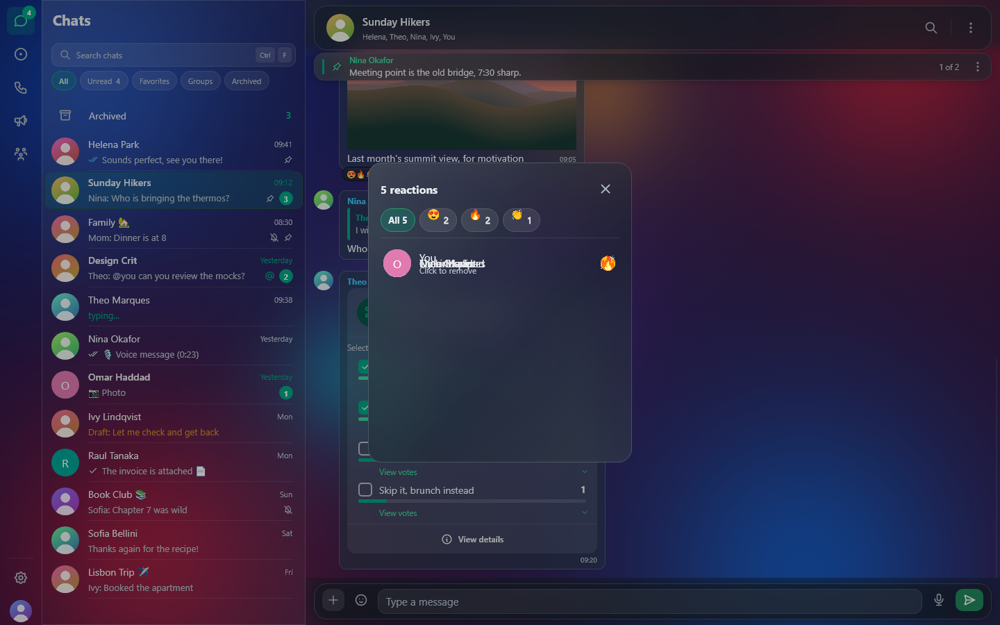
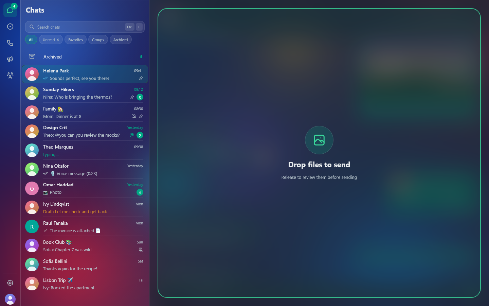
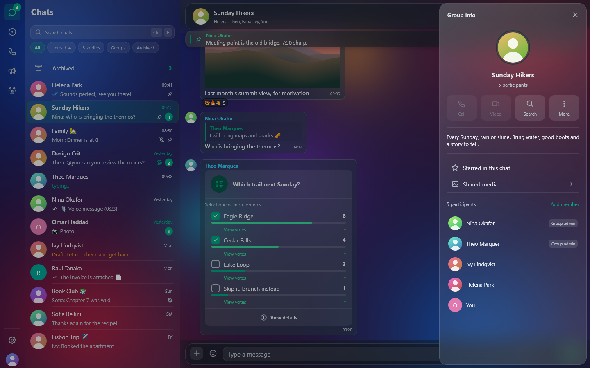
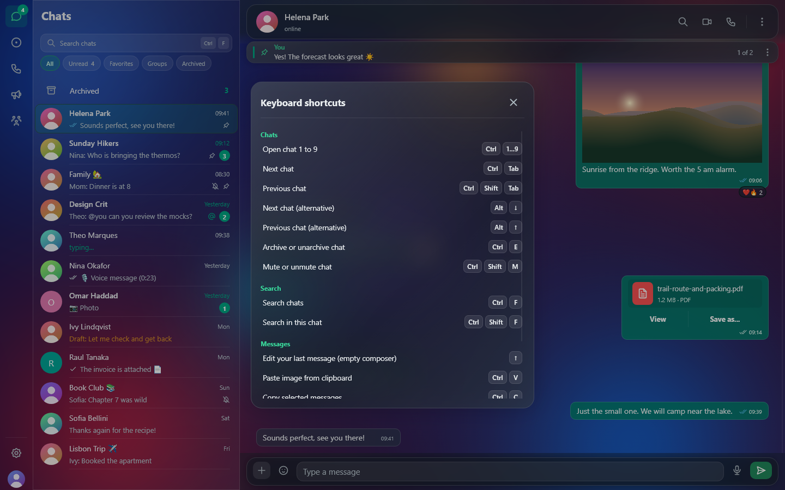

# Features

This page describes what Zapive does today and the settings that control
each feature. Anything not listed here is in
[Not yet supported](#not-yet-supported).

- [Chat list](#chat-list)
- [Conversations](#conversations)
- [Polls](#polls)
- [Starred and pinned messages](#starred-and-pinned-messages)
- [Reactions](#reactions)
- [Writing and sending](#writing-and-sending)
- [Media](#media)
- [Voice notes](#voice-notes)
- [Documents and PDF](#documents-and-pdf)
- [Calls](#calls)
- [Status, channels and communities](#status-channels-and-communities)
- [Groups and contact info](#groups-and-contact-info)
- [Search](#search)
- [Accounts](#accounts)
- [Desktop integration](#desktop-integration)
- [Keyboard](#keyboard)
- [Settings reference](#settings-reference)
- [Not yet supported](#not-yet-supported)

## Chat list

- Pinned, archived and muted chats, unread counters and an `@` badge for
  unread mentions. Chat previews come from stored metadata, so the list
  appears instantly on launch.
- **Filter chips:** All, Unread, Favorites, Groups and Archived, plus any
  **lists** you create ("Add to list" → "New list"). The chips scroll
  sideways when there are many.
- **Chat menu:** archive or unarchive, mute or unmute, add to or remove
  from Favorites, add to a list, select messages, export the chat, clear
  messages on this device, close, delete, or exit a group.
- **Drafts:** text you leave in a chat's composer is kept and shown as
  "Draft:" in the list.
- **Hover prefetch:** resting the pointer on a chat for 120 ms loads its
  latest messages so opening it is instant.

## Conversations

- Bubbles for text, images, video, GIFs, stickers, voice notes, audio,
  documents, contacts (vCard), locations and live locations,
  [polls](#polls), view-once media and system notices.
- Group bubbles show the sender name in a stable colour.
- **Message menu:** reply, reply privately (groups), react, forward, copy,
  copy image, copy link, save as, edit (your messages), pin or unpin, star
  or unstar, mark as unread, select, details, delete.
- **Edits and deletions** that arrive from other devices are applied.
  - A "deleted for everyone" from someone else **does not erase the
    message by default**: it is kept with a "deleted by sender" marker.
    Change this in **Settings → Privacy → Apply messages deleted by the
    sender**.
  - You can delete your own messages for everyone, or any message for
    yourself.
- **Message details** show the timestamps and delivery state.
- **Delivery ticks in groups** follow every member: a message shows two
  grey ticks once **all** other members have received it, and turns
  **blue only when every member has read it**. Until the member list is
  known, it stays at one tick, so it never turns blue early.
- **Selection mode** (chat menu → Select messages, or drag over messages):
  copy (`Ctrl+C`), forward or delete several messages at once. Destructive
  actions ask for a second click.
- **Disappearing messages:** off, 24 hours, 7 days or 90 days per chat,
  from the info panel.
- **Older history:** scroll up to fetch older messages from the phone. A
  sync dialog shows the progress.
- **Link previews:** a card with the title and thumbnail. Zapive refuses
  to fetch addresses on your own computer or local network.
- **Translation:** see [translation.md](translation.md).

## Polls

| A poll with results | Creating a poll |
| --- | --- |
|  |  |

- **Create** a poll from the attach menu → **Poll**: a question (up to
  255 characters) and 2 to 12 options (up to 100 characters each), with
  **Allow multiple answers** on or off. Blank and duplicate options are
  dropped. Nothing is sent if the poll is invalid or you can't write in the
  chat.
- **Vote** by clicking an option. In single-choice polls a click replaces
  your answer, and clicking your current answer again clears it. In
  multiple-choice polls each click toggles one option. Your vote shows at
  once and is synced to your other devices.
- **Results** update live as votes arrive from other people and devices
  (they are decrypted locally with the poll's key). **View votes** lists
  who picked each option.
- Polls you received before linking, or whose key isn't available, are
  shown read-only.

## Starred and pinned messages



- **Starred messages:** chat menu (⋮) → **Starred messages** lists stars
  from **all chats**, and the info panel → **Starred in this chat** lists
  only the open chat's. Each entry shows the sender, chat, time and a
  snippet; clicking it opens the chat at that message. Stars sync with the
  phone.
- **Pinned banner:** a glass strip under the chat header shows the current
  pinned message. Clicking it jumps to the message and moves on to the
  next pin ("1 of 3"). Its menu can **Unpin**. Pins come from any device
  and expire on schedule (Zapive pins for 7 days).

## Reactions



- Click the reaction badge under a bubble to open **reaction details**:
  an **All** tab and one tab per emoji, each listing who reacted.
- Your own entry says **You · Click to remove**; clicking it removes your
  reaction.
- React from the message menu with the quick row or the full emoji picker.

## Writing and sending

- `Enter` sends and `Shift+Enter` adds a new line.
- WhatsApp formatting is rendered: `*bold*`, `_italic_`, `~strike~`,
  ```` ```monospace``` ````.
- **Mentions:** type `@` in a group to pick a member. `@all` is
  supported.
- **Replies, reactions and forwarding** use the message menu. Forwarding
  opens a chat picker with search.
- **Editing** puts the message back in the composer.
- **Attachments:** photos, videos, documents, audio files and stickers
  from the attach menu. Paste an image with `Ctrl+V` to send it. Photos
  can be cropped in the preview before sending, get a caption, or be sent
  as **view-once**. Stickers are converted to 512 px WebP.
- **Drag and drop:** drag files from your file manager onto the window
  ("Drop files to send"). Up to **10 files** of up to **100 MB** each join
  a review queue ("1 of 3"); folders, empty files and duplicates are
  skipped. Images open in the editor (crop, caption), and other files show
  a document card. Each item is sent only when you confirm it.

  
- **GIFs:** search through Openverse in the picker. The chosen GIF is sent
  as a looping MP4, like the phone apps do.
- **Emoji picker** with the full Unicode set and colour emoji.
- **Outbox:** messages and attachments sent while offline wait in an
  encrypted outbox. They are sent when the connection returns and survive
  a restart.

## Media

- **Images:** open in a full-window lightbox. GIFs open in an enlarged,
  animated view.
- **Video:** a streaming player with play/pause, seek bar, volume, mute
  and save-as. The soundtrack stays in sync, and clips play at their own
  frame rate.
  - Keys: `Space`/`K` play/pause, `←`/`→` seek 5 s, `↑`/`↓` volume, `M`
    mute, `Esc` close.
  - Formats: H.264/MP4 (what WhatsApp uses) and GIF. Other containers such
    as HEVC or MKV show as documents without preview.
- **Shared media** gallery in the info panel.
- **Automatic downloads** per type in **Settings → Downloads**: photos,
  audio, videos, documents, stickers. All are on by default. Voice notes
  always download.
- Media is cached **encrypted** on disk; see
  [privacy-and-security.md](privacy-and-security.md).

## Voice notes

- Real waveforms, seek, and speeds of **1x, 1.5x, 2x, 2.5x and 3x** with
  the pitch preserved (WSOLA time-stretch).
- A mini player keeps the current note playing while you move to other
  chats.
- Recording from the microphone, encoded directly to Ogg/Opus like the
  phone apps.
- Notes from others are marked as played only if **Send read receipts** is
  on.

## Documents and PDF

- Documents open in Zapive or with **Open with another app**.
- **PDF viewer in the app.** On first use it downloads the pdfium
  rendering engine once (about 7 MB, from the `bblanchon/pdfium-binaries`
  releases) into the data folder. The viewer has zoom controls.

## Calls



- **One-to-one voice and video calls** from a chat header or the info
  panel. You can also accept or decline incoming calls.
- In-call controls: mute or unmute, start or stop video, end.
- Video is H.264, encoded from the camera and decoded in-process. Audio is
  16 kHz mono through `cpal`.
- **Settings → Calls:** choose the microphone, speaker and camera. Changes
  apply to the next call.
- **Calls page:** a log of incoming and outgoing calls, including group
  calls that rang on other devices, with answered, missed, declined and
  "answered on another device" states.
- If a call arrives while you are already on one, it is declined
  automatically. Offers that are too old never ring.
- **Not supported:** starting or joining group calls, call links, screen
  sharing.

## Status, channels and communities

- **Status:** a viewer for your contacts' recent updates, with photo and
  video playback and stepping between updates. Posting a status is not
  supported.
- **Channels** (newsletters) with their metadata, and **communities**,
  each in their own section of the left rail with unread counts.

## Groups and contact info

- The info panel shows the photo, about, shared media, groups in common,
  the member list and admin badges.
- **Admins** can add members and remove, promote or demote them.
- When only admins can send, the composer says so. When you have left a
  group, the composer explains why you cannot send.
- Mute, favorite, lists and disappearing messages are set here too.

## Search

- One search box finds chats by name and messages by content
  (`Ctrl+F`).
- Message search uses SQLite FTS5 over an **encrypted index**: diacritics
  don't matter ("joao" finds "João"), and the last word matches as a
  prefix, so "reuni" finds "reunião".
- How the index stays private: see
  [privacy-and-security.md](privacy-and-security.md#search-index).

## Accounts

- Up to **five** WhatsApp accounts, **all connected at the same time**.
  Messages, notifications and history keep arriving for every account,
  whichever one is on screen.
- Switching is instant: click another account's avatar in the left rail
  (it shows that account's unread chats), or open the switcher from your
  own avatar at the bottom. A dot on your avatar means another account
  has unread messages.
- With more than one account, banners name the account they belong to;
  clicking one switches to that account and opens the chat.
- Calls can be answered only on the account on screen. A call to another
  account shows a banner naming it and keeps ringing on the phone.
- Each account has its own session (`wa-<id>.db`) and search index; all
  share the one encrypted vault.
- **Log out** offers to keep the conversations. Removing an account
  deletes its local data.

## Desktop integration

- **Notifications:** native toasts, a click that opens the chat, inline
  reply and play, and a message chime. See
  [notifications.md](notifications.md).
- **Tray (Windows):** closing the window hides it to the tray. The tray
  menu opens or exits Zapive.
- **Start at login** (**Settings → General**). On Windows, an autostarted
  Zapive starts in the tray.
- **Single instance:** launching Zapive again brings the running window to
  the front.
- **Updates:** see [releases.md](releases.md#self-update).

## Keyboard

| Keys | Action |
| --- | --- |
| `Ctrl+/` | Show or hide the shortcut list |
| `Ctrl+1` … `Ctrl+9` | Open chat 1 to 9 of the visible list |
| `Ctrl+Tab` / `Ctrl+Shift+Tab` | Next / previous chat |
| `Alt+↓` / `Alt+↑` | Next / previous chat (alternative) |
| `Ctrl+E` | Archive or unarchive the open chat |
| `Ctrl+Shift+M` | Mute or unmute the open chat |
| `Ctrl+F` | Search chats |
| `Ctrl+Shift+F` | Search in this chat |
| `↑` (empty composer) | Edit your last message |
| `Enter` / `Shift+Enter` | Send / new line |
| `Ctrl+V` | Paste text or an image (an image opens the send preview) |
| `Ctrl+C` | Copy the selected messages (selection mode) |
| `Esc` | Close the topmost panel (what's new, video, lightbox, PDF, menus, dialogs, send preview) |
| `Space` / `K`, `←` `→`, `↑` `↓`, `M` | Video: play/pause, seek, volume, mute |

On macOS, `Cmd` replaces `Ctrl` in the shortcut list.



## Settings reference

Settings are grouped into sections, and the search field at the top
filters them.

| Section | Options |
| --- | --- |
| Account | Log out (keep or erase conversations) |
| General | Start at login, interface language (System, English, Portuguese; restart to apply) |
| Appearance | Theme (Dark, Light, System) · Style (Liquid Glass, Opaque) · Chat wallpaper (background colour, doodle colour, intensity, reset); see [appearance.md](appearance.md) |
| Notifications | Banners on/off · Show message previews · Message sound; see [notifications.md](notifications.md) |
| Privacy | Send read receipts (off) · Apply messages deleted by the sender (off) · Blur names, photos, message text, media |
| Security | Set, change or remove the PIN |
| Downloads | Auto-download photos, audio, videos, documents, stickers |
| Calls | Microphone, speaker, camera |
| Translation | Service start/stop, source and target language, install or remove models; see [translation.md](translation.md) |
| AI integration | MCP server on/off, URL, token, copy client config, regenerate token; see [mcp.md](mcp.md) |
| Updates / About | Version, check for updates, what's new, download and restart |

## Not yet supported

Gaps we know about, not permanent decisions:

- Group calls, call links, screen sharing, posting statuses.
- Blocking contacts, creating groups, invite links, `wa.me` deep links.
- Locked chats, auto-lock after inactivity, and a proxy.
- Privacy settings for typing, last seen and online.
- Importing or creating sticker packs, interactive or business messages,
  sending locations, broadcast lists, album grids.
- Full screen-reader coverage, and more than two UI languages.
