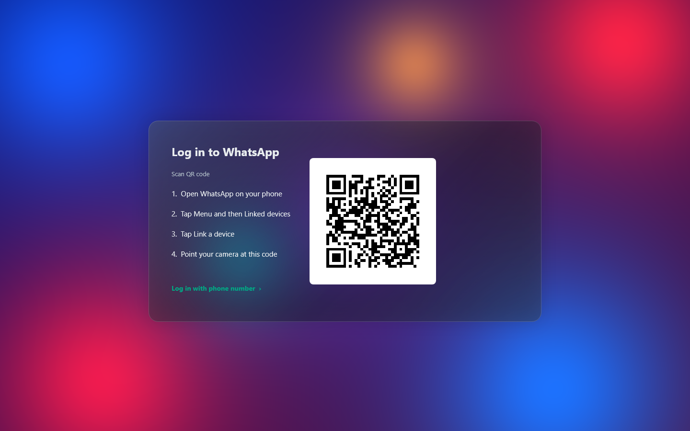
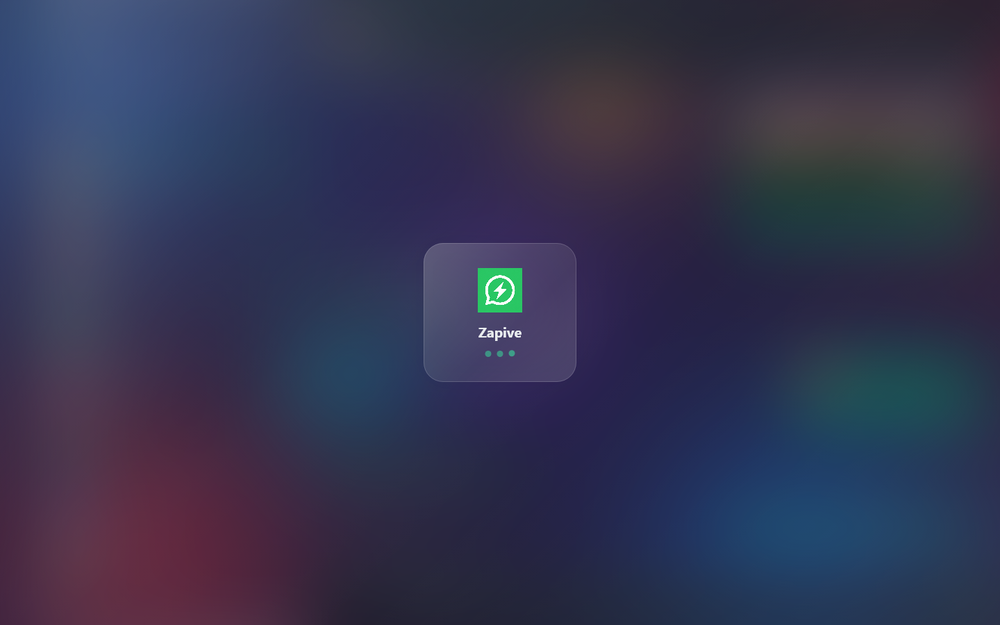

# Getting started

## 1. Install

Download the file for your system from
[Releases](https://github.com/wilssola/zapive/releases/latest).

### Windows 10 / 11 (x64)

1. Run `Zapive-Setup-<version>.exe`. It installs to `Program Files\Zapive`.
2. The installer and the executable are **self-signed**. SmartScreen may say
   the publisher is unknown; choose **More info → Run anyway**.

Windows also needs `ctranslate2.dll` and `libiomp5md.dll` next to
`zapive.exe` for translation. The installer and the self-updater put them
there. If they are missing, the app still starts and only translation
reports an error.

### Linux (x86_64)

```sh
chmod +x Zapive-<version>-x86_64.AppImage
./Zapive-<version>-x86_64.AppImage
```

Install `secret-tool` (package `libsecret-tools` on Debian/Ubuntu,
`libsecret` on Fedora/Arch) and keep a Secret Service keyring running (GNOME
Keyring or KWallet). Zapive stores its vault key there. Without it, the key
is kept with weak protection; see
[privacy-and-security.md](privacy-and-security.md#os-key-store).

A Flatpak manifest exists in `packaging/flatpak/` but is not published yet.

### macOS 11+ (Apple silicon)

1. Open `Zapive-<version>.dmg` and drag **Zapive** to Applications.
2. The app is self-signed, so the first launch is blocked. Right-click the
   app and choose **Open**, or allow it in **System Settings → Privacy &
   Security**.

## 2. Link your phone

Zapive is a **linked device**: your phone stays the main device, and
Zapive uses the same mechanism as WhatsApp Web.



**With a QR code**
1. On the phone: WhatsApp → **Settings → Linked devices → Link a device**.
2. Point the camera at the QR code in Zapive.

**With a phone number**
1. In Zapive, choose to link with a phone number and type your number with
   the country code.
2. On the phone, choose **Link with phone number instead** and type the
   code Zapive shows.

Zapive appears on the phone's Linked devices list as Windows, Mac OS or
Linux.

## 3. First sync

A loading screen stays up until the first chat list is ready.



- Chats appear first, then history arrives in the background. Older
  messages of a chat can be fetched on demand from the phone.
- Messages already received are stored in the encrypted vault, so the next
  launch is instant.

## 4. Recommended first settings

Open **Settings** (gear in the left rail):

| Section | Suggestion |
| --- | --- |
| Security | Set a PIN if other people use this computer account. |
| Privacy | Read receipts are **off** by default. Turn them on if you want others to see the blue ticks. |
| Notifications | Choose banners, message previews and the message sound. |
| Downloads | Choose which media types download automatically. |
| Appearance | Pick Liquid Glass or Opaque, and dark, light or system. |
| General | Start Zapive when you sign in. |

## More accounts

Zapive keeps up to **five** WhatsApp accounts, all connected at once. Add
one from the avatar at the bottom of the left rail and scan its QR code.
The other accounts appear as small avatars in the rail with their unread
count; click one to switch instantly.

## Logging out

Logging out asks whether to **keep the conversations** on this computer.
If you keep them, linking the same number again continues from them
instead of downloading everything once more. Also remove the device from
the phone's Linked devices list.
