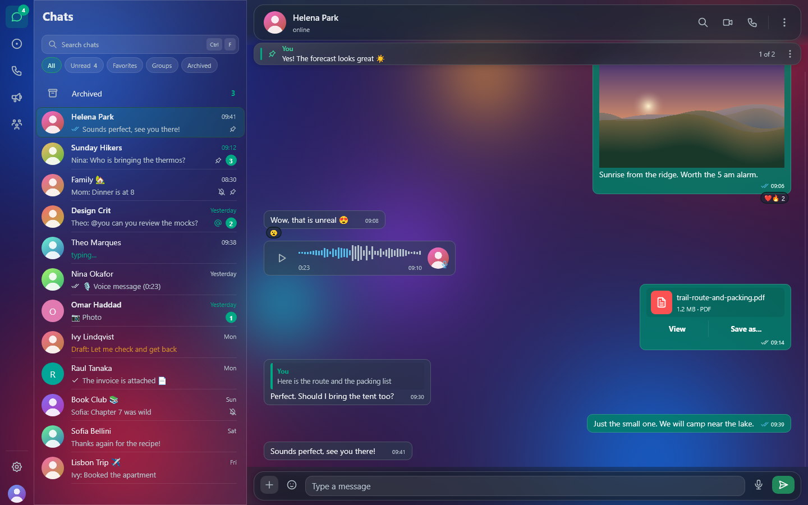

# Zapive documentation

Zapive is a native WhatsApp desktop client written in Rust. It links to your
phone as a companion device and runs as a single process with no browser
engine.

## Guide

| Page | What it covers |
| --- | --- |
| [Getting started](getting-started.md) | Install on Windows, Linux or macOS, link your phone, first sync |
| [Features](features.md) | Every feature with its behaviour and the related settings |
| [Notifications](notifications.md) | Native toasts, opening a chat from a toast, the message sound |
| [Appearance](appearance.md) | Liquid Glass vs Opaque, dark, light and system themes, language |
| [Translation](translation.md) | Offline translation with CTranslate2 and Argos models |
| [MCP server](mcp.md) | Letting local AI assistants use Zapive: tools, token, risks |
| [Troubleshooting](troubleshooting.md) | Common problems and how to fix them |
| [FAQ](faq.md) | Short answers |

## Reference

| Page | What it covers |
| --- | --- |
| [Privacy and security](privacy-and-security.md) | Vault, keys, what is stored where, network traffic, threat model |
| [Architecture](architecture.md) | Threads, module map, crates |
| [Building](building.md) | Building from source on each OS, checks, self-tests, packaging |
| [Demo mode](demo-mode.md) | Running on invented data and regenerating screenshots |
| [Releases](releases.md) | Versioning, commit rules, release notes, self-update |

## Project files

- [README](../README.md): overview
- [CONTRIBUTING](../CONTRIBUTING.md): how to contribute (in Portuguese)
- [SECURITY](../SECURITY.md): reporting vulnerabilities (in Portuguese)
- [packaging/README](../packaging/README.md): installers and signing

> Zapive is not affiliated with or endorsed by WhatsApp or Meta.
